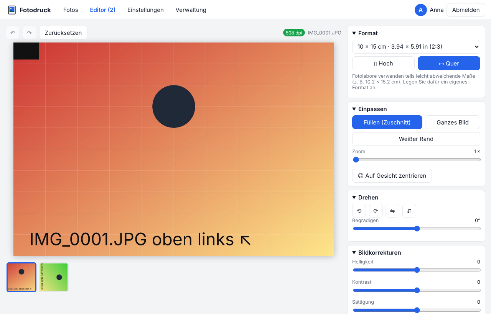

# Fotodruck

**Fotos auf Standardformate einpassen, als neues Bild speichern oder direkt drucken – mit oder ohne eigenen [Immich](https://immich.app)-Server.**



- Fotos hochladen oder aus Immich wählen (Alben, Zeitleiste, Suche)
- auf 10 × 15, DIN A4, Passbild und viele weitere Formate einpassen, zuschneiden, drehen, korrigieren
- als JPEG, PNG oder PDF in exakter Größe speichern, als neues Bild in Immich ablegen oder drucken – im Browser oder über CUPS, auch mehrere Bilder auf einem Blatt
- mehrere Nutzer, Anmeldung über Immich (auch per OAuth, z. B. Authentik) oder eigene Konten

> Fotodruck ist ein **unabhängiges Open-Source-Projekt** und nicht mit dem Immich-Projekt verbunden. Keine Telemetrie, keine Tracker, keine externen Dienste.

## Schnellstart

```bash
SESSION_SECRET=$(openssl rand -hex 32) docker compose up -d
```

Dann <http://localhost:8080> öffnen und das erste Administratorkonto anlegen. Ohne weitere Einstellungen läuft Fotodruck ohne Immich. Wie man Immich, Traefik, OAuth und Drucker anbindet, steht in der Dokumentation.

Image für amd64 und arm64: `ghcr.io/scazadar/foto-print-tool`. Tags: `latest` = letztes Release, `edge` = aktueller Stand von `main`.

## Dokumentation

| | |
| --- | --- |
| [Installation](docs/installation.md) | Docker Compose, neben Immich, hinter Traefik, alle Einstellungen |
| [Anmeldung](docs/anmeldung.md) | Anmeldemodi, OAuth mit Authentik, API-Key |
| [Drucken](docs/drucken.md) | Browser-Druck und CUPS, Beispiel Canon PIXMA TS6200 |
| [Bedienung](docs/bedienung.md) | Fotos wählen, Editor, Ausgabe, Bogenlayout |
| [Fehlersuche](docs/fehlersuche.md) | häufige Probleme und Lösungen |
| [Mitwirken](CONTRIBUTING.md) | Entwicklung, Tests, Releases |

Beispiel-Compose-Dateien liegen unter [examples/](examples/).

## Lizenz

Copyright (C) 2026 Fotodruck contributors. Freie Software unter der [GNU Affero General Public License v3.0 oder später](LICENSE), Drittlizenzen in [THIRD_PARTY_LICENSES.md](THIRD_PARTY_LICENSES.md). Wer eine veränderte Version für andere im Netz betreibt, muss ihnen den Quellcode anbieten (AGPL §13): dafür `SOURCE_URL` auf den eigenen Fork setzen.

---

## English

Fotodruck fits photos to standard print sizes (10 × 15 cm, DIN A4, passport photos …), saves the result as JPEG, PNG or PDF at the exact size, stores it as a new image in [Immich](https://immich.app) or prints it via the browser or CUPS. It works with or without Immich and supports several users, including login through Immich's OAuth provider (e.g. Authentik). Independent project, not affiliated with Immich; no telemetry.

Quick start: `SESSION_SECRET=$(openssl rand -hex 32) docker compose up -d`, then open <http://localhost:8080>. Image: `ghcr.io/scazadar/foto-print-tool` (amd64, arm64).

The user interface and the detailed documentation in [docs/](docs/) are in German. Licence: AGPL-3.0-or-later.
