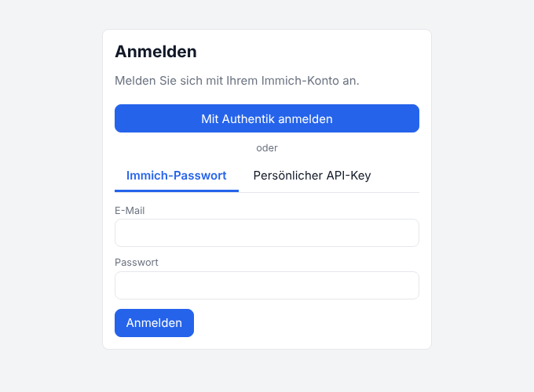

# Anmeldung



- [Anmeldemodi](#anmeldemodi)
- [Mit dem Immich-Konto anmelden](#mit-dem-immich-konto-anmelden)
- [OAuth mit Authentik](#oauth-mit-authentik)
- [Persönlicher API-Key](#persönlicher-api-key)
- [Eigene Konten (AUTH_MODE=local)](#eigene-konten-auth_modelocal)
- [Gastzugang](#gastzugang)
- [Sicherheit](#sicherheit)

## Anmeldemodi

Den Modus legt `AUTH_MODE` fest:

| Modus | Wer meldet sich wie an | Standard |
| --- | --- | --- |
| `immich` | Jeder mit seinem Immich-Konto: OAuth, Immich-Passwort oder API-Key | wenn `IMMICH_URL` gesetzt ist |
| `local` | Eigene Konten in Fotodruck (E-Mail und Passwort). Jeder kann sein Immich-Konto zusätzlich verbinden. | ohne Immich |
| `none` | Keine Anmeldung, ein gemeinsamer Nutzer. Nur für einen einzelnen Nutzer im Heimnetz. | – |

Zusätzlich kann ein [Gastzugang](#gastzugang) ohne Konto erlaubt werden (`GUEST_ACCESS=true`).

In jedem Modus sieht jeder Nutzer nur seine eigenen Uploads, Einstellungen und Druckaufträge. Anfragen an Immich laufen immer mit den Rechten des angemeldeten Nutzers, es gibt keinen gemeinsamen Immich-Schlüssel.

## Mit dem Immich-Konto anmelden

Im Modus `immich` bietet die Anmeldeseite bis zu drei Wege:

| Weg | Wann |
| --- | --- |
| **Button des OAuth-Anbieters**, z. B. „Login with OAuth“ | wenn in Immich OAuth aktiv ist. Text und Anbieter kommen aus Immich. |
| **Immich-Passwort** | wenn das Konto in Immich ein Passwort hat und Immich den Passwort-Login erlaubt |
| **Persönlicher API-Key** | immer, z. B. wenn nur OAuth erlaubt ist und kein Passwort existiert |

Name und Profilbild oben rechts kommen aus Immich. Admins in Immich sind auch in Fotodruck Admins.

Abmelden beendet die Sitzung in Fotodruck und das Immich-Token. Läuft das Token in Immich ab, landet man wieder auf der Anmeldeseite.

## OAuth mit Authentik

Fotodruck braucht **keinen eigenen Client** beim Anbieter. Es nutzt den OAuth-Zugang, den Immich schon hat, wie die Immich-App: Immich schickt den Browser zu Authentik und gibt Fotodruck danach ein Immich-Token.

Voraussetzung: Die Anmeldung bei Immich über Authentik funktioniert (*Immich → Administration → Einstellungen → OAuth*).

### 1. Fotodruck einstellen

```yaml
    image: ghcr.io/scazadar/foto-print-tool:latest   # OAuth ab Version 0.2.0
    environment:
      IMMICH_URL: http://immich-server:2283
      PUBLIC_URL: https://druck.example.de           # Adresse von Fotodruck im Browser
      TRUST_PROXY: "true"                            # hinter Traefik o. ä.
```

`PUBLIC_URL` mit `https://`, ohne `/` am Ende. Neue Umgebungsvariablen übernimmt der Container erst beim Neuerstellen:

```bash
docker compose up -d --force-recreate fotodruck
```

### 2. Redirect-URI in Authentik eintragen

1. In Authentik *Anwendungen → Provider* öffnen und den Provider bearbeiten, **den Immich nutzt**.
2. Bei **Redirect URIs/Origins** einen Eintrag hinzufügen, Modus *strict*:
   ```
   https://druck.example.de/api/auth/oauth/callback
   ```
   Die Einträge für Immich bleiben stehen.
3. Speichern.

Die Adresse ist immer `PUBLIC_URL` + `/api/auth/oauth/callback` und muss Zeichen für Zeichen übereinstimmen.

### 3. Testen

Fotodruck öffnen: Oben auf der Anmeldeseite steht der OAuth-Button. Er erscheint, sobald Fotodruck Immich erreicht; die Einstellung wird bis zu einer Minute zwischengespeichert. Klicken, bei Authentik anmelden, fertig.

Andere Anbieter (Authelia, Keycloak, Google …) funktionieren genauso: Bei dem Client, den Immich nutzt, die Rückruf-Adresse von Fotodruck als zusätzliche Redirect-URI eintragen.

Probleme: siehe [Fehlersuche → Anmeldung](fehlersuche.md#anmeldung).

## Persönlicher API-Key

1. In Immich oben rechts auf das Profilbild → **Kontoeinstellungen → API-Schlüssel → Neuer API-Schlüssel**.
2. Namen vergeben, z. B. „Fotodruck“, und diese Rechte auswählen:

   `asset.read`, `asset.view`, `asset.download`, `asset.upload`, `asset.update`, `album.read`, `album.create`, `albumAsset.create`, `person.read`, `face.read`, `user.read`, `userProfileImage.read`

3. Den Schlüssel kopieren (Immich zeigt ihn nur einmal) und in Fotodruck im Reiter **Persönlicher API-Key** einfügen.

Der Schlüssel bleibt nach dem Abmelden in Immich gültig, bis Sie ihn dort löschen. Fotodruck vergisst ihn beim Abmelden.

## Eigene Konten (AUTH_MODE=local)

- Das erste Admin-Konto entsteht über den Einrichtungsassistenten oder `ADMIN_EMAIL`/`ADMIN_PASSWORD`.
- Admins legen unter **Verwaltung** Nutzer an, setzen Passwörter zurück und können die Selbstregistrierung erlauben (Standard: aus).
- Jeder Nutzer kann unter **Einstellungen → Immich-Konto** sein Immich-Konto verbinden: per OAuth-Button (die Redirect-URI wie oben eintragen), Immich-Passwort oder API-Key.

## Gastzugang

Mit `GUEST_ACCESS=true` steht auf der Anmeldeseite zusätzlich **Als Gast fortfahren**. Das funktioniert in den Modi `immich` und `local`.

| Gäste können | Gäste können nicht |
| --- | --- |
| Fotos hochladen, bearbeiten, herunterladen | Immich nutzen (keine Fotos, kein Speichern, kein Verbinden) |
| im Browser drucken, Bogenlayout | über den Netzwerkdrucker (CUPS) drucken |
| eigene Formate und Voreinstellungen anlegen | die Verwaltung öffnen |

Die Sperren gelten auf dem Server, nicht nur in der Oberfläche.

- Jeder Gast bekommt ein eigenes, vorübergehendes Konto und sieht nur seine eigenen Fotos.
- Beim **Abmelden** wird alles sofort gelöscht, sonst spätestens nach `GUEST_SESSION_HOURS` (Standard 24).
- Pro Gast höchstens `GUEST_MAX_UPLOADS` Fotos (Standard 30), pro IP-Adresse höchstens 20 neue Gastzugänge pro Stunde. Hinter einem Proxy dafür `TRUST_PROXY=true` setzen.
- Gäste erscheinen nicht in der Benutzerliste der Verwaltung.

```yaml
    environment:
      GUEST_ACCESS: "true"
      GUEST_SESSION_HOURS: 24
      GUEST_MAX_UPLOADS: 30
```

Der Gastzugang ist offen für jeden, der Fotodruck erreicht. Öffentlich im Internet daher nur mit Bedacht einschalten, z. B. nur im Heimnetz oder hinter einer Zugangsbeschränkung im Proxy.

## Sicherheit

- Immich-Tokens und API-Keys liegen nur auf dem Server, verschlüsselt mit AES-256-GCM (Schlüssel aus `SESSION_SECRET`). Der Browser bekommt nur ein Sitzungscookie (`HttpOnly`, `SameSite=Lax`, bei HTTPS `Secure`).
- Passwörter eigener Konten werden mit Argon2id gespeichert, Fehlversuche pro IP begrenzt.
- OAuth nutzt `state` und PKCE; der Ablauf muss innerhalb von 10 Minuten im selben Browser abgeschlossen werden.
