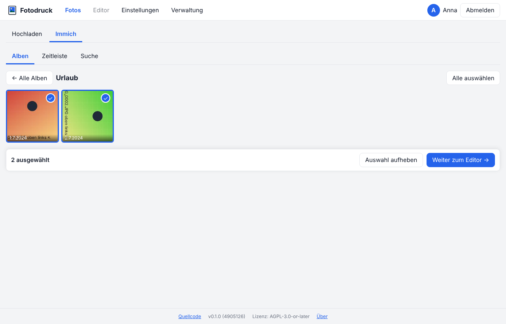
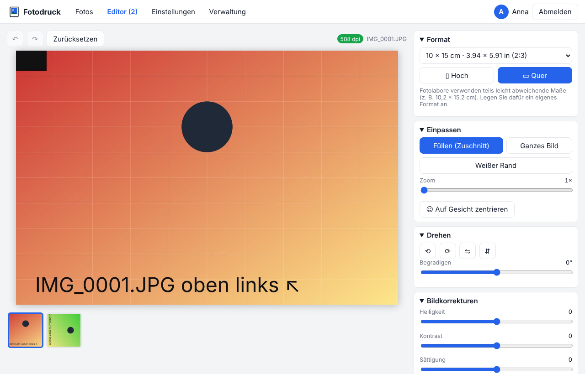
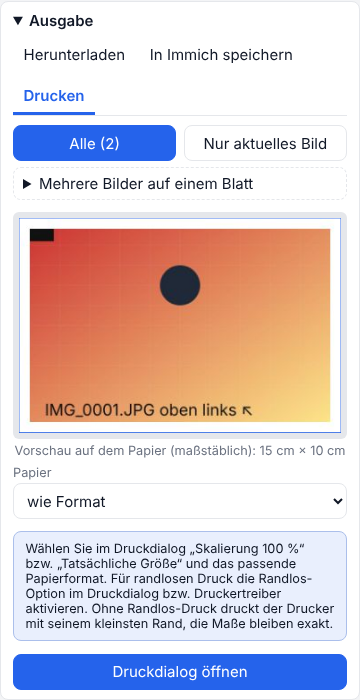
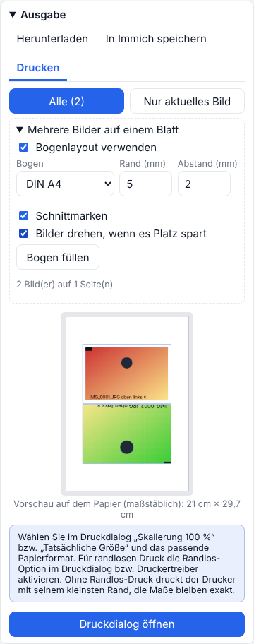

# Bedienung

Der Weg ist immer gleich: **Fotos wählen → im Editor einpassen → ausgeben** (herunterladen, in Immich speichern oder drucken).

- [1. Fotos wählen](#1-fotos-wählen)
- [2. Format und Ausschnitt](#2-format-und-ausschnitt)
- [3. Ausgeben](#3-ausgeben)
- [Mehrere Bilder auf einem Blatt](#mehrere-bilder-auf-einem-blatt)
- [Einstellungen](#einstellungen)

## 1. Fotos wählen

**Hochladen:** Fotos in das Feld ziehen, **Dateien auswählen** oder mit Strg+V einfügen. Am Smartphone zusätzlich **Foto aufnehmen** und **Aus Galerie**. Möglich sind JPEG, PNG, WebP, HEIC/HEIF (iPhone), TIFF und AVIF. Hochgeladene Fotos stehen unter **Meine Uploads** und werden nach einigen Tagen automatisch gelöscht (die Frist steht darunter).

**Immich** (nur wenn verbunden): **Alben**, **Zeitleiste** oder **Suche** nach Text („Strand“), Datum, Ort oder Person.

Fotos antippen zum Auswählen, auch mehrere. Dann unten auf **Weiter zum Editor**.

## 2. Format und Ausschnitt

**Format** wählen, z. B. 10 × 15, und **Hoch** oder **Quer**. Beim ersten Öffnen passt Fotodruck die Ausrichtung an das Foto an. Zuletzt benutzte Formate stehen oben in der Liste. Eigene Formate (z. B. die 10,2 × 15,2 cm eines Fotolabors) unter [Einstellungen](#einstellungen).

**Einpassen:**

| Modus | Ergebnis |
| --- | --- |
| **Füllen (Zuschnitt)** | Das Format ist voll, überstehende Teile werden abgeschnitten. Standard. |
| **Ganzes Bild** | Das ganze Foto ist sichtbar, freie Flächen werden weiß, schwarz, in einer Farbe oder mit einer unscharfen Version des Fotos gefüllt. |
| **Weißer Rand** | Wie Füllen, mit Rand in mm; unten zusätzlich breiter für den Polaroid-Look. |

**Ausschnitt:** Das Bild in der Vorschau mit Maus oder Finger verschieben, mit Mausrad, Zoom-Regler oder zwei Fingern vergrößern. Pfeiltasten und +/− gehen auch.

**Drehen:** in 90°-Schritten, mit **Begradigen** fein ±45° (mit Gitter), dazu spiegeln. **Auf Gesicht zentrieren** gibt es bei Fotos aus Immich mit erkannten Gesichtern.

**Bildkorrekturen:** Helligkeit, Kontrast, Sättigung, Farbtemperatur, Schärfe, dazu Schwarz-Weiß, Sepia und **Auto** (Tonwertkorrektur). Doppelklick auf einen Regler setzt ihn zurück.

**Text im Rand:** z. B. Datum oder Bildunterschrift; schaltet automatisch den weißen Rand ein.

**Hilfslinien:** Drittel-Gitter, 3-mm-Sicherheitsrand und bei Passbildern die Schablone für Kopfhöhe und Augen.

**Rückgängig / Wiederholen** oben links (auch Strg+Z / Strg+Y), **Zurücksetzen** stellt den Ausgangszustand her. Das Original wird nie verändert.

**Druckqualität:** Oben rechts steht die Auflösung des sichtbaren Ausschnitts:

| Anzeige | Bedeutung |
| --- | --- |
| grün, ab 300 dpi | sehr gute Druckqualität |
| gelb, 150–299 dpi | ausreichend, bei genauem Hinsehen evtl. unscharf |
| rot, unter 150 dpi | zu gering, der Druck wird unscharf |

Hineinzoomen senkt die Auflösung.

**Mehrere Fotos:** Die Leiste unter der Vorschau zeigt alle gewählten Fotos; jedes lässt sich einzeln anpassen. Das Format gilt für alle. **Einstellungen auf alle anwenden** überträgt Einpassmodus und Korrekturen, nicht den Ausschnitt.

## 3. Ausgeben

Im Bereich **Ausgabe** unten rechts. Bei mehreren Fotos zuerst wählen: **Alle** oder **Nur aktuelles Bild**.

| Reiter | Was passiert |
| --- | --- |
| **Herunterladen** | JPEG, PNG oder PDF in exakter Größe (10 × 15 bei 300 dpi = 1181 × 1772 Pixel). Mehrere Bilder als ZIP bzw. mehrseitiges PDF. |
| **In Immich speichern** | Als neues Bild in Immich, mit dem Aufnahmedatum des Originals (steht in der Zeitleiste daneben), optional in einem Album und mit Beschreibung. Danach erscheint ein Link „In Immich öffnen“. |
| **Drucken** | Im Browser oder über einen Netzwerkdrucker, siehe [Drucken](drucken.md). |

Gerendert wird immer aus dem Original in voller Auflösung, die Vorschau zeigt dasselbe Ergebnis.

**Browser-Druck:** Papier wählen („wie Format“ oder z. B. A4, das Foto wird dann mittig in exakter Größe gesetzt), **Druckdialog öffnen**, und dort **Skalierung 100 %** bzw. **Tatsächliche Größe** wählen.

## Mehrere Bilder auf einem Blatt

Im Reiter der Ausgabe **Mehrere Bilder auf einem Blatt** aufklappen und **Bogenlayout verwenden** anhaken:

- **Bogen:** DIN A4, DIN A3, Letter oder 10 × 15.
- **Rand** und **Abstand** in mm, **Schnittmarken** an oder aus.
- **Bilder drehen, wenn es Platz spart:** Fotodruck dreht einzelne Bilder um 90°, wenn so mehr auf das Blatt passen.
- **Bogen füllen:** setzt beim aktuellen Bild so viele Kopien, wie auf den Bogen passen, z. B. 8 Passbilder auf 10 × 15 (Rand 3 mm, Abstand 1 mm).
- Die Kopien pro Bild stehen im Editor bei **Kopien**.

Der Bogen lässt sich herunterladen, in Immich speichern oder drucken.

## Einstellungen

Oben unter **Einstellungen**:

- **Voreinstellungen:** Standardalbum für Druckversionen (wird bei Bedarf angelegt), Standard-Einpassmodus, JPEG-Qualität, Auflösung, cm oder Zoll, GPS-Daten übernehmen (Standard: aus).
- **Formate verwalten:** eigene Formate anlegen, bearbeiten, löschen; mitgelieferte Formate ausblenden oder mit **Anpassen** als eigenes Format mit anderen Maßen übernehmen.
- **Immich-Konto** verbinden oder trennen (nur bei eigenen Konten).
- **Passwort ändern** (nur bei eigenen Konten).

Admins finden unter **Verwaltung** die Nutzer, die Selbstregistrierung und die Auswahl der sichtbaren Drucker.
